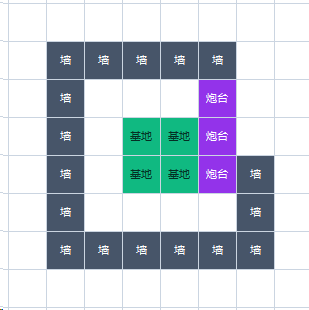
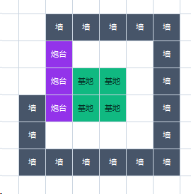

# 己方 17 墙布局与维修通路

v1.2.9，2026-10-12。根据用户本轮两张蓝图更新默认己方基地模板。本文坐标以官方 `station.pos`（2×2 基地的左上格）为 `B=(bx,by)`；横向向右、纵向向上。模板选择依据基地实际横坐标，与 `teamOur.type` 无关。





## 左侧基地与镜像

左侧基地采用下表相对偏移。右侧基地将每个偏移 `(dx,dy)` 变为 `(1-dx,dy)`，围绕基地中心 `x=bx+0.5` 水平镜像。

| 用途 | 左侧基地相对偏移 | 数量 |
|---|---|---:|
| 火箭发射台 | `(-1,1)`、`(-1,0)`、`(-1,-1)` | 3 |
| 开拓者操炮位 | `(-2,0)` | 1 |
| 上沿城墙 | `dy=2, dx=-1..3` | 5 |
| 下沿城墙 | `dy=-3, dx=-2..3` | 6 |
| 正面城墙 | `dx=3, dy=-2..1` | 4 |
| 后下方城墙 | `dx=-2, dy=-2,-1` | 2 |

三台炮与操炮位沿用上一版的位置；城墙从原来的 12 块增加为 17 块。操炮位到三台炮均为切比雪夫距离 1。上述武器格距基地主体为 1，墙格为 2。`Settings.build_cells()` 仍检查地图边界、可通行地图格及正确建造环，不把蓝图解释为建造区域放宽。带 `verified=True` 的自定义布局仍优先于默认模板。

相对图如下，`B` 是基地、`R` 是炮、`W` 是墙、`P` 是操炮位。点号表示本图未放建筑的格子，不代表地图上必然为空地。

```text
       dx -2 -1  0  1  2  3
 dy  2     .  W  W  W  W  W
 dy  1     .  R  .  .  .  W
 dy  0     P  R  B  B  .  W
 dy -1     W  R  B  B  .  W
 dy -2     W  .  .  .  .  W
 dy -3     W  W  W  W  W  W
```

## 升级与维修

升级顺序保持原策略：集中升满第一台火箭；正对基地的两堵墙升满；第二台火箭升 2；正面其余 4 块含上下拐角墙升满；所有火箭升满；其它 11 块墙升 2。基地不升级。

`upgrade_policy.wall_group()` 将左侧模板的 `dx=3` 列（含上下两个拐角）视为正面。其中 `dy=0,-1` 是中央两块，其他 4 块是正面次优先墙；镜像后等价。新增的 5 块墙属于侧后方，目标等级为 2。升级和重建只依据真实观测，不预先模拟血量恢复或建筑存在。

内侧一格宽维修通路包含 `dy=1,-2, dx=0..2`、`(2,0)`、`(2,-1)`，以及新增后下方维修站位 `(-1,-2)`。该通路在基地与炮台之间、上下两侧连续，能在一格内触及全部 17 块墙。站位与路线需要同时排除真实建筑、队友、当轮预约和操炮位，保留已有工人协作避让。

## 白天临时入口与夜间完整蓝图

三炮和 17 墙同时存在时，蓝图里的后上方开口只连接炮台外侧，无法通往内侧维修通路。炮台同样阻挡移动。因此不能把该开口误认为工人从商店或矿区返回基地内部的通道。

默认模板使用上沿最靠后的一块墙作临时入口：左侧基地为 `B+(-1,2)`，镜像为 `B+(2,2)`。**白天暂缓建造或拆开这一块；傍晚由携带 1 石头的负责人从内侧补建；夜间恢复图片里的完整 17 墙。**其它 16 块墙照常建造，不扩大官方建墙区域。次日白天重新开门，让工人继续采矿、卖矿和补给。这是本地策略，官方没有新增“门”建筑或“穿墙”动作。

`DayGate.day_ready()` 与物理闭合是两个判定。派侦察工人前，必须真实看见三炮和其它应建城墙均完成，并且门负责人真实携带至少 1 石头、有实际路径与时间返回封口。敌人占据的原墙仍由已有缺口策略单独处理；不能把任意缺墙当作受控入口。`FirstNightDefense.closed()` 始终检查真实 17 块墙，发出 `build` 不会提前改变它。

如果敌人恰好占据这个临时入口墙位，仍采用已有工人/捣乱鬼肉身补位策略，检查负责人能到达该缺口的待命格；不强制穿过被占的入口回到内侧，也不增建其它墙来绕过官方建造范围。

封口与移动分别占用一轮。双工维修阶段，负责人会先让出入口的内侧单格位置，让另一人通过，再从内侧封墙，防止互相卡在门边。需要回防的工人实际进入内侧后才允许封口；侦察工人继续在敌方供视野，不强制拉回。门负责人在卖矿时只保留 1 石头，其余石头仍可按原经济策略售卖。

拆墙不返还材料，重新建造也不会保留旧等级。每日开关入口因此消耗 1 石头。完成非门的全部原定升级后，门负责人日间预备 1 张 `WallUpgradeVoucher1`，等实际封门后再使用，使门恢复 2 级；券价为 20 金币。采购遵守背包容量、剩余白天、实际回程以及 BOSS/普通建设的预算，不抢第一天 BOSS 购券和原定升级的资金。无资金或时间时仍优先封上 1 级墙，不能为了升门保持缺口或在夜间非法建墙。

配置里明确验证的自定义布局不会自动启用此临时入口；该流程只针对本轮默认蓝图。完整新图与开门状态都有独立几何测试，真实日志通过 `day_gate` 展示门位置、负责人、封口阶段、石头/券库存及物理墙是否齐全。

## 修改入口与本地验证

| 文件 | 作用 |
|---|---|
| `app/config.py` | `base_surrounding_offsets()` 生成 17 墙相对模板；`mirrored_layout()` 决定左右镜像；`build_cells()` 检查合法建造环 |
| `src/agent/construction.py` | `select_defense_layout()` 选择固定三炮和共享操炮位，临时角色占位不改变计划 |
| `src/agent/upgrade_policy.py` | 升级分组、目标等级及完整升级完成判定 |
| `src/agent/wall_guard.py` | 内侧维修站位、两工人的巡逻和修复包供应 |
| `src/agent/day_gate.py` | 默认蓝图的日间入口、单石保留、双工通过和傍晚封口；升级全部完成后预备门券 |
| `tests/test_day_gate.py` | 入口与闭合几何、实际通行、预算与容量、封口/拆门及双工回防 |
| `tests/test_u_layout.py` | 精确 17 格、镜像、施工、通路与三炮轮转 |
| `tests/test_default_opening.py` | 默认开局、合法建造环及配置优先级 |
| `tests/test_maintenance.py`、`tests/test_focused_upgrades.py` | 17 墙升级、真实反馈、补建及双工维修 |

这些验证使用本地合成观测；不代表官方比赛结果。官方建造、移动和昼夜规则仍以项目根目录 `32_docs/` 为准。
