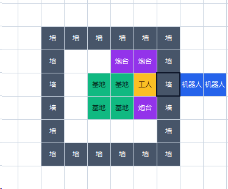
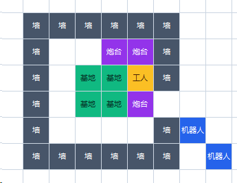
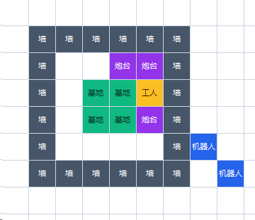
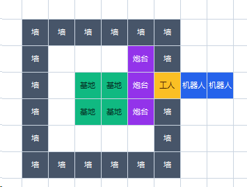

# 首日敌方布局侦察与按阵型召唤

v1.2.8，2026-10-12。当前首日采用“建防线并派侦察工人、完成两任务后购券、真实布局及当前视野就绪后用券”的流程。任务与采购数量见[FIRST_DAY_PLAN.md](FIRST_DAY_PLAN.md)；本页说明视野、阵型、召唤选点、夜间破墙及后续修改入口。

## 可见性与判定依据

[v2.0任务书](../../32_docs/任务书.md)§4.3与[接口文档](../../32_docs/接口文档.md)§1.4规定：普通己方角色、基地、墙及炮台的视距为4，全队共享；敌基地与墙全局可见，敌炮台、工人、开拓者需进入己方视野。用户转述工作人员补充：**召唤机器人没有视野**。全图能看见机器人，不代表它能揭开周围敌单位。

正式策略只消费当前HTTP观测，不创建隐藏敌人。推断操炮位用于侦察和召唤规划，不能直接当成真实攻击目标。敌基地/墙在观测中出现，也不能当成工人已探明敌炮台的证据。

`RaidScouts.seen(cell)`检查活的普通己方单位到格子的切比雪夫距离是否≤4，排除召唤机器人。真实可见炮台记录到`GameMemory.enemy_structures`；炮台暂时不可见时只保留静态规划信息，只有当前位置被普通己方视野明确覆盖且炮台已缺失/死亡时才清理。当前可见的死亡、重建及同位置替换优先于旧记录。

## 首日角色分工与时点

| 角色 | 建设、任务与购买阶段 | 召唤准备与第一夜 |
|---|---|---|
| 开拓者 | 先尝试并结束两个任务，再按成功数冻结0／1／2张，资金满足时批买 | 等真实侦察就绪；可先返回己方操炮位等待，再远程逐张用券；入夜仍控制己方火箭 |
| 留守工人 | 完成防线、采购及采矿经济；被占墙位先略过 | 既有缺口待命/肉身阻挡及墙内维修优先 |
| 侦察工人 | 三炮及可建原墙实际完成后立即出发，不等待L2火箭或维修包 | 探明真实敌炮阵，随后持续提供操炮区视野；不因普通采矿任务离开 |
| 捣乱鬼 | 沿用既有首夜观察与毁矿调度，缺口后备更优先 | 存在己方缺口时留家接力；其它情况下可辅助侦察和共享视野 |

必须至少有两名活工人，派遣者排除留守及缺口负责人；选定身份后不每轮替换。侦察工人死亡后不把唯一活留守工人再派走。原墙被敌角色占据时，先确认其余原墙建齐并保留缺口工人，由另一人探路。没有额外围墙、拆临墙或5回合恶意占点判定。

最后一条`build`发出后，须等下一次实际观测显示墙存在，才算建设完成。路线无解或剩余白天不足时不强派；白天又出现待补原墙时暂停工人侦察调度。身份和已扫记录保留，条件恢复后再继续。

购券不等待敌方视野；只有实际`use`增加侦察门槛。火箭升级采购仍在开拓者购券尝试后解锁，无须等召唤完成。零任务成功、无法采购或首日窗口关闭时释放相关经济阶段。

## 布局扫描与当前视野是两种状态

敌基地为2×2，`pos`是左上格`B=(bx,by)`。12个合法武器格为：

```text
x = bx-1 .. bx+2
y = by-2 .. by+1
去掉基地主体 (bx,by)、(bx+1,by)、(bx,by-1)、(bx+1,by-1)
```

`enemy_weapon_cells(turn)`还会裁掉地图外格。没有把完整6×6墙区扩大成武器区。

布局就绪满足其一：已经真实观察到三座存活炮台，数量达到总上限；或者12个合法武器格全部曾进入普通己方视野。后一条使敌方只建0／1／2台炮时仍能完成探查，不永久等第三台。`surveyed`仅累计实际进入视野的武器格，步行目标及镜像模板不算已扫。

闭合墙环外的一名工人通常不能一瞬间看完整个6×6防区。因此先沿外侧扫描尚未看到的武器格，取得布局后转为覆盖操炮位的待命任务。`surveyed_count`是历史扫描进度，`uncovered_operators`是当前未覆盖操炮格，二者不能互相代替。

每次`use`还需同时满足：敌方活基地真实存在于当前观测；己方可建防线完成；指定侦察工人当前活着、未接管缺口、且至少两工存活；该工人实际靠近敌武器圈；布局已就绪；推断的共同操炮位及本轮可见炮旁工人/开拓者均在当前普通己方共享视野内。到站命令不会提前创造本轮视野，要等后续观测。

`layout_operator_positions(turn, remembered)`枚举真实炮台八邻格，排除基地、炮台、墙、矿/NPC等不能站立的位置，保留可同时操作炮台数最多的格。三炮有共同位则优先这些格；没有三炮共同位时取最大可控制数量的位置，不假设对手一定采用本方模板。可见炮旁工人/开拓者的当前格也加入观察集合。

观察点选在敌基地建造圈之外，排除待生成/已确认召唤点、其它观察者预约点、当前BOSS到操炮位的已知射线路径。稳定目标、覆盖数量、危险估值及实际路程共同决定位置；左右后排参考点只作平局偏好。扫描转待命时允许更换目标。侦察路径与工人的实际协作路线均保留已见静态建筑的避障，避免再次撞入隐身炮台。

## 召唤位置与四张参考阵型

用户参考图原样保存在`docs/assets/`，仅用于解释与回归对照，不被正式策略导入。

| 图1：完整右墙 | 图2：右下缺口 |
|---|---|
|  |  |
| 图3：右下封闭 | 图4：右侧直射开口 |
|  |  |

实际用券调用`scouted_spawn_position(...)`，使用真实基地、墙、炮台和已扫格；对镜像、平移、不同方向炮阵逐格评分，不硬编码图片绝对坐标。召唤仍不能落在双方建造区、NPC、任务点或己方已用待生成位置；动态占用虽可合法旁移，排序中会降低优先级。

优先考虑本轮真实可见炮手；没有可见炮手时以共同操炮位作规划目标。候选按能否形成直射、到可射击格的八方向路程、必要墙拆除代价、可操作炮台数、出生占用等比较。两个BOSS使用不同合法坐标；必要时选择对同一堵墙形成共同拆除，避免分别浪费火力。基地/炮台挡住操炮者且无法高效触及时，保留攻击基地的回退方案。

| 用户图片 | 实际屏障与当前策略 |
|---|---|
| 图1：右侧操炮者、完整墙环 | 外侧射线有一堵真实墙；先拆这一堵，后直射可见炮手 |
| 图2：右下墙缺口 | 通过缺口利用恰45度射线，侧边擦角墙不阻挡 |
| 图3：封闭右下角 | 45度对角线上存在真实墙，需要先拆一堵，不会把封闭角落误判为缺口 |
| 图4：纵列三炮、右侧开口 | 沿开口水平直射共同操炮位，减少移动和无效破墙 |

图中的蓝格是参考位置；正式选择依据当前场景。保持切比雪夫射程3、每回合只移动或攻击之一。恰45度只检查对角线格，旁边两墙触角不阻挡；对角线上的墙仍阻挡。

历史`rear_spawn_position`只用于购券前的合法空间可行性检查。后方贴边没有位置时可检查其它方向；它不再决定实际用券落点。无全图合法位置时不买，不预留无法使用的份额。

## 夜间单墙突破与失去视野

用券收到库存/关联反馈确认后记录`scouted_spawns`，开启已侦察部署的单墙突破模式。`RobotRaider.direct_crew_breach(robot,target)`仅针对**当前可见存活工人/开拓者**：目标在射程3内；当前只有一堵墙阻挡；BOSS可直接攻击该墙；假设拆掉这一堵后，目标射线没有其它墙或已知基地/炮台内部遮挡；剩余夜间足够拆墙并至少打一发炮手。

这条路线允许攻击1000HP墙，不再因25次拆墙攻击超过默认4回合追路预算而半途绕走。前轮破墙攻击有合法反馈，或当前观测确认同一目标血量下降时，将其视为有效工作而不累加无效追路轮数；合法反馈本身不证明实际伤害或击杀。失败射击缓存、剩余时间和每轮重读敌人HP继续生效。

直接可攻击炮手仍优先；没有合适单墙路线时保留短距离追位、原有限破墙及基地回退。炮手回血、换位或重新进入炮旁都用当前观测重评估；丢失视野时不向旧格或推断格开火。无可见炮手时转攻全局可见活基地，并清理旧炮手追击状态。

## 生命周期、经济与失败处理

持券但视野未齐时，开拓者先返家再待命，避免接第三次任务挤掉剩余用券窗口。每次用券都检查当前视野和位置；两张券分两个回合用，不能同回合两条角色动作。`pending_buy/pending_use`仍须等待真实库存和匹配反馈，重复HTTP帧由服务缓存处理，不重复购买或计账。

若剩余白天已不足全部用券及回防，置`summon_window_closed`，保留背包实物券，返回防守并停止新增BOSS消费；不以盲目召唤追赶时限。零目标、第二天、关闭BOSS、敌基地毁或首夜本方BOSS全部消失时结束侦察。已部署但尚未生成的BOSS仍可保持观察等待第一夜；第二张券时限过期也不撤走第一只已部署或存活BOSS的视野支持。观察结束后工人和捣乱鬼恢复原调度。

## 关键文件、函数与参数

| 源码位置与入口 | 参数、返回值及维护用途 |
|---|---|
| `src/agent/raid_scouts.py: RaidScouts(strategy)` | 当前`Strategy`；初始化真实扫描、固定身份、存活及防线状态 |
| `seen(cell)` / `update_survey()` | `Pos→bool`；更新普通单位真实视野和`surveyed`，不依赖BOSS视野 |
| `walls_ready()` / `refresh_readiness()` / `summon_ready()` | 检查可建防线、当前活工人、布局及操炮位覆盖；最终返回`bool`供用券门使用 |
| `operator_cells()` / `watch_cells()` | `set[Pos]`；前者合并共同操炮位和可见炮手，后者在扫描/待命两阶段切换观察目标 |
| `post(role)` / `scout_route(role)` | `Unit→Pos或None / Routes`；选建造圈外观察点并避开已见建筑、召唤位和射线 |
| `spawn_cells()` / `attack_lanes()` | `set[Pos]`；读取真实待生成/部署点和本方BOSS位置，生成观察避让集合 |
| `worker(role)` / `imp(role)` / `observe_from(role)` | 是否接管`Unit`；每轮移动一步或待命；缺口职责优先 |
| `src/agent/summoning.py: enemy_weapon_cells(turn)` | `Turn→frozenset[Pos]`；敌基地实际12格武器圈 |
| `enemy_layout_weapons(turn, remembered=())` | 当前观测与已见`Unit`序列→真实炮台集合；当前死亡/重建覆盖旧记录 |
| `enemy_layout_ready(turn, remembered=(), surveyed=())` | 三炮真实已见或合法武器圈扫满→`bool` |
| `layout_operator_positions(turn, remembered=())` | 真实炮阵→操控炮台数最多的可站位置元组；不是敌人实体 |
| `scouted_spawn_candidates(turn, settings, remembered=(), pending=(), failed=(), surveyed=())` | `remembered`已见静态单位；`pending`待生成/已用位置；`failed`失败格；`surveyed`实际已扫格。返回按效率排序的合法`Pos`元组 |
| `scouted_spawn_position(...)` | 相同参数，返回最佳`Pos`或`None` |
| `src/agent/boss_raid.py: spawn_positions(count, scouted=False)` | `count`需要的不同位置数；`False`只作买前可行性，实际`use`必须`True` |
| `BossRaid.pioneer(role)` / `observe()` | `Unit→接管标志`；购券→等待侦察→逐张用券→返岗，按库存和关联反馈确认部署 |
| `src/agent/robot_raider.py: direct_crew_breach(robot,target)` | 本方`Robot`和当前可见敌`Unit`→可突破的单墙或`None`；不接受推断炮手 |
| `RobotRaider.decide(robot)` | 每轮选择当前炮手、短追路/单墙突破或基地，只发原生`move/attack` |
| `src/agent/brain.py: movement_reserved(role)` | 侦察工人实际协作路线同步记忆建筑、召唤位和射线避让 |
| `app/service/memory.py` | `raid_scouts`、`enemy_structures`、`boss_raid.scouted_spawns`保存同局实际证据 |
| `app/service/turn_service.py` | 日志及同回合缓存；正式HTTP响应字段不变 |

没有新增官方请求字段、第三方依赖或必填配置。`enable_boss_raid`控制首日采购、侦察及BOSS操控；`enable_robot_diagnostics`只控制原机器人诊断，不改变策略。视距4和射程3是规则参数，不作为可随意调大的实验配置。

保留`app/config.py`中的`boss_controller_max_walk=4`作为绕路/无效追位预算，`return_margin=4`作为首日交互后回防余量，`summon_build_margin=2`作为建造圈排除底线；显式配置的召唤余量可以扩大，不能让合法圈层缩小。完整墙前的有效单墙攻击不按`boss_controller_max_walk`逐发耗尽，但仍受剩余夜间、失败反馈及当前真实目标限制。

## 日志与本地验证入口

| 日志标记 | 排查内容 |
|---|---|
| `raid_survey` | `walls_ready/worker_id/home_worker_id`、`surveyed_count/weapon_cells`、`weapons/layout_ready`、`worker_near`、`operator_cells/uncovered_operators`、`summon_ready/readiness_reason`及当前站位 |
| `first_day_policy` | 两任务接取/结束/成功数、冻结购券数、buy尝试轮、升级采购门、BOSS预算、`scout_ready/summon_window_closed`及当轮开拓者原因 |
| `boss_raid` | 真实券库存、pending反馈、确认部署数、`spawns/scouted_spawns`；部署数不等于本方BOSS当前存活数 |
| `raid_scout` | 观察身份、`posts.mode=survey/watch`、旅行/待命状态、路径预算与当前命令 |
| `robot_observation/robot_diagnostic` | 实际生成ID和位置、前轮反馈、当前可见炮手HP、墙/射线、`breach_reason`和最终动作 |

先定位`readiness_reason`：`enemy_base_unconfirmed`不能拿镜像作真基地确认；`waiting_for_walls`检查实物防线；`no_live_scout/scout_travelling`检查工人；`layout_incomplete`检查炮台及扫格；`operator_out_of_sight`检查当前覆盖。开拓者`waiting_for_scout:*`与上述原因关联，`scout_window_expired`表示时间预算终止，不能继续等待或重复购券。

本轮实际测试、压力与HTTP结果由[VALIDATION-v1.2.8.md](../../reports/VALIDATION-v1.2.8.md)记录。局部视野回归必须在普通己方单位真实视距内才传入敌炮/角色，不能把全图敌人列表当正常观测。合成HP和反馈只能验证流程，不能证明官方伤害、解题成功率或胜率；本轮未运行新的官方比赛。
